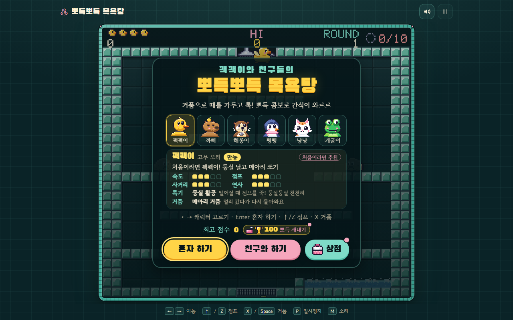
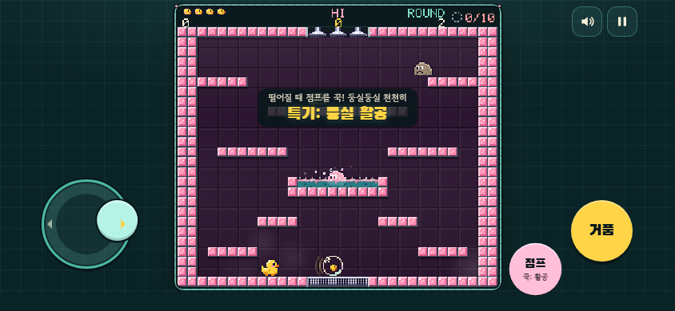
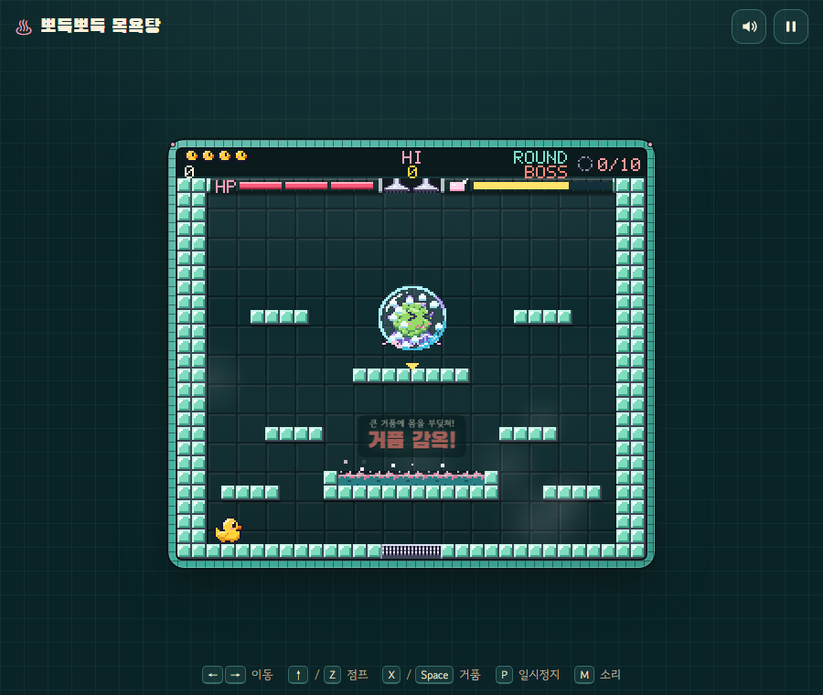
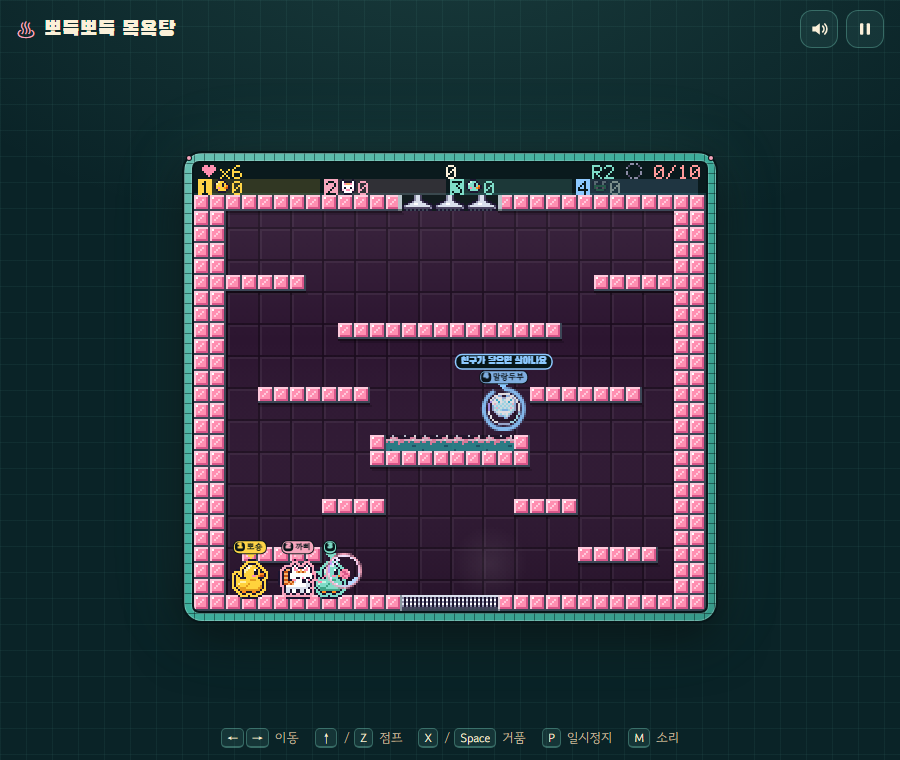
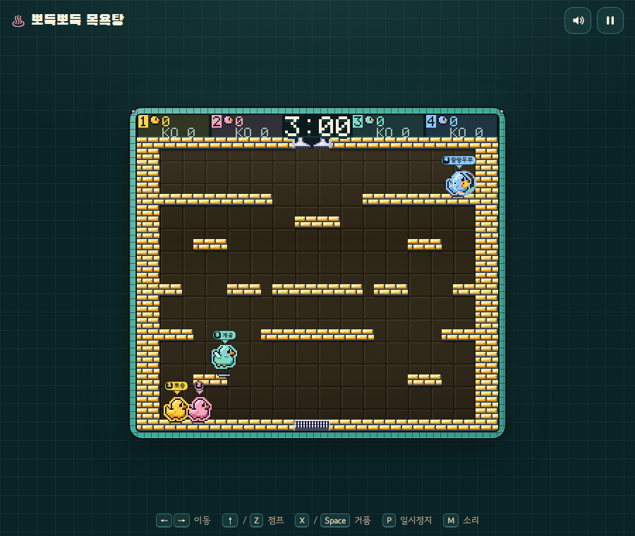
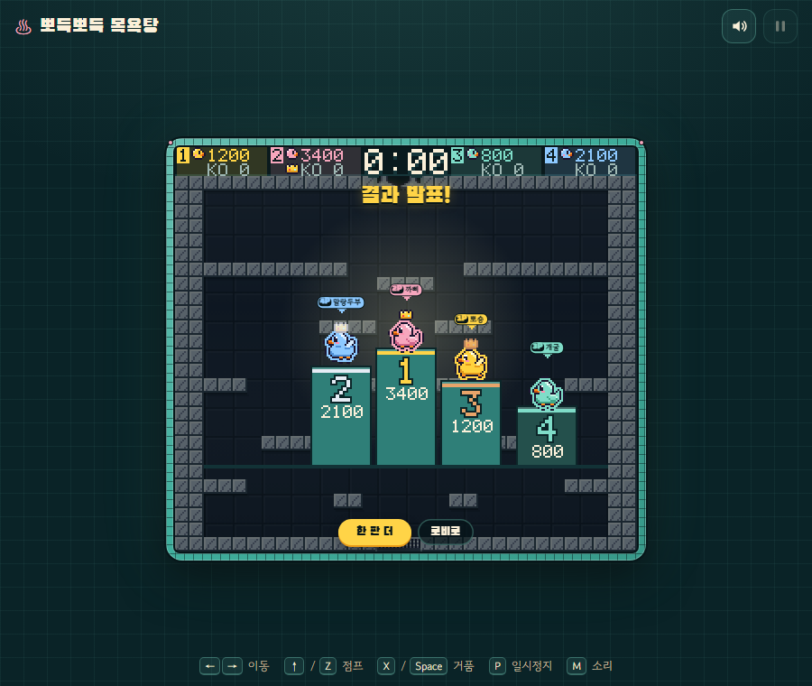
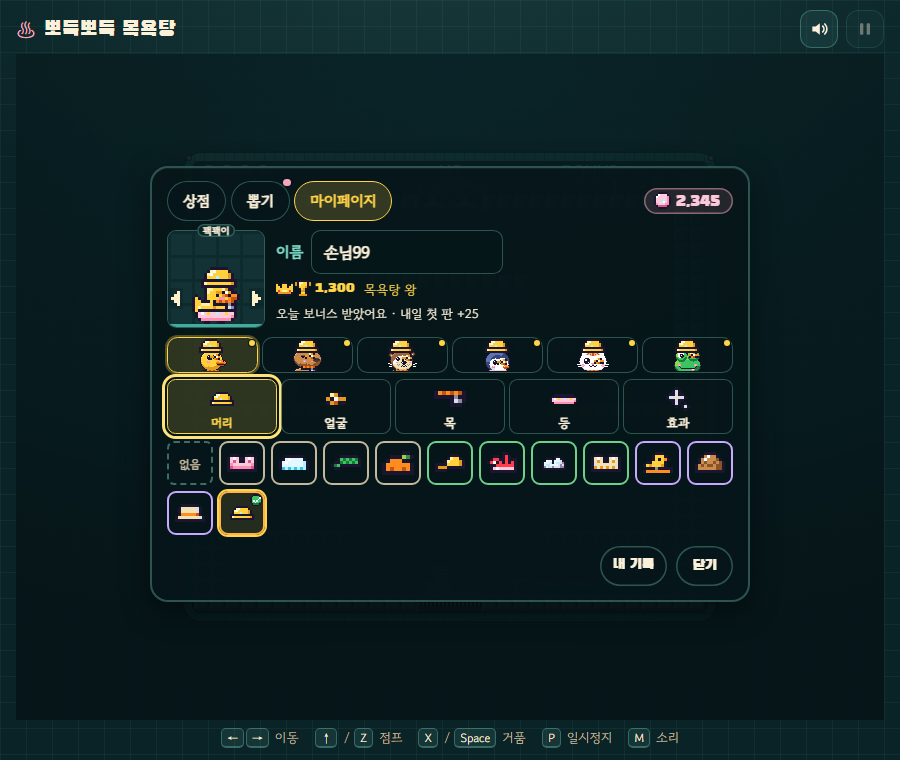
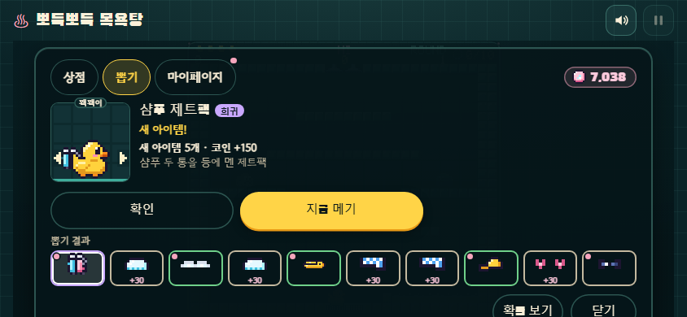
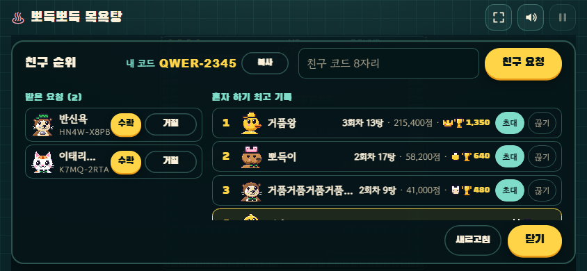
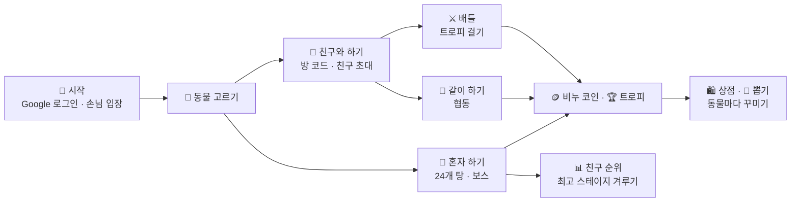

# 🛁 뽀득뽀득 목욕탕

**비누 거품으로 때 몬스터를 쏙 가두고 톡 터뜨리는 픽셀 목욕탕 아케이드, 동물 친구 여섯 마리와 혼자 · 같이 · 배틀로 즐겨요**

[▶ 웹에서 플레이](https://bubble-c3ad4.firebaseapp.com) · [📱 폰에서 하기](#-폰에서-하기) · [🎮 조작법](#-조작법) · [🛠 개발 · 배포 흐름](#-개발--배포-흐름) · [📝 설계 문서](design/) · [📝 기획 기록](docs/PM-기록.md)

---

## 어떤 게임인가요?

뽀득뽀득 목욕탕은 **거품을 쏴서 몬스터를 가두는 고전 아케이드 방식**을 목욕탕 세계관으로 새로 만든 게임이에요.
탕마다 숨어 있는 때 몬스터를 비누 거품에 가둔 다음, 거품을 터뜨려 간식으로 바꾸고, 한 번에 여러 마리를 터뜨리면 **뽀득 콤보**가 터져요.

- 🐤 **동물 친구 6마리**: 저마다 다른 특기와 거품을 가지고 있어요
- 🧼 **24개의 탕과 보스**: 냉탕, 온탕, 사우나를 지나 커다란 보스와 싸워요
- 👫 **친구와 온라인으로**: 최대 4명이 같이 하기(협동)나 배틀(대전)을 해요
- 🏆 **트로피 · 리그**: 배틀에서 트로피를 걸고 겨루며 '때밀이 견습'부터 '목욕탕 왕'까지 올라가요
- 🛍️ **꾸미기**: 플레이로 모은 비누 코인으로 상점과 뽑기에서 아이템을 얻어 동물마다 따로 입혀요
- 📊 **친구 순위**: 친구 코드로 친구를 맺고 혼자 하기 최고 기록을 겨뤄요. 친구 목록에서 바로 초대할 수도 있어요
- 📱 **폰에서도**: 홈 화면에 앱처럼 설치하고, 가로 화면에서 조이스틱으로 플레이해요

## 화면

| 혼자 하기 (폰 가로) | 보스 |
|---|---|
|  |  |
| 왼쪽 엄지로 조이스틱, 오른쪽으로 점프 · 거품 | 거품에 갇힌 보스에 몸을 부딪쳐 공격해요 |

| 같이 하기 (협동) | 배틀 (대전) |
|---|---|
|  |  |
| 쓰러진 친구는 거품이 되고, 닿으면 살아나요 | 친구를 거품에 가두고 터뜨리면 뽀득 KO! |

| 배틀 결과 | 상점 · 마이페이지 |
|---|---|
|  |  |
| 순위대로 트로피를 주고받아요 | 비누 코인으로 사고, 동물마다 따로 입혀요 |

| 비누 캡슐 뽑기 | 친구 순위 |
|---|---|
|  |  |
| 뽑기에서만 나오는 아이템 10종, 확률은 모두 공개 | 혼자 하기 최고 스테이지로 친구와 순위를 겨뤄요 |

## 동물 친구들

| | 이름 | 역할 | 특기 | 거품 | 배틀 장전 |
|---|---|---|---|---|---|
| 🐤 | **꽥꽥이** (고무 오리) | 만능 | 둥실 활공: 떨어질 때 점프를 꾹! 둥실둥실 천천히 | 메아리 거품: 멀리 갔다가 다시 돌아와요 | 3발 · 2.2초 |
| 🦫 | **까삐** (카피바라) | 든든 | 털썩 엉덩방아: 공중에서 점프 한 번 더! 쿵, 때가 불어요 | 왕방울 거품: 크고 느릿느릿, 잘 맞아요 | 2발 · 1.2초 |
| 🦦 | **해롱이** (해달) | 돌격 | 휙 대시: 공중에서 점프 한 번 더! 옆으로 휙 | 물장구 거품: 세 갈래로 촤악 퍼져요 | 2발 · 1.6초 |
| 🐧 | **펭펭** (펭귄) | 저격 | 쭉 배미끄럼: 공중에서 점프 한 번 더! 배로 쭉~ | 고드름 거품: 빠르게 아주 멀리 날아가요 | 2발 · 1.3초 |
| 🐱 | **냥냥** (고양이) | 곡예 | 냥냥 2단 점프: 공중에서 점프 한 번 더! 더 높이 | 털실 거품: 땅에서 쏘면 통통 굴러가요 | 4발 · 2.4초 |
| 🐸 | **깨굴이** (개구리) | 함정 | 깨굴 3단 뛰기: 착지하자마자 또 점프! 점점 높이 | 개구리알 거품: 앞에 멈춰 기다리는 함정 | 3발 · 1.8초 |

배틀에서는 거품을 다 쏘면 잠깐 장전해요. 쏘지 않고 장전 시간만큼 기다리면 다시 꽉 차요 (능력 끄기: 모두 3발 · 2초).

## 플레이 흐름

## 📱 폰에서 하기

1. 폰 브라우저로 **[bubble-c3ad4.firebaseapp.com](https://bubble-c3ad4.firebaseapp.com)** 에 들어가요.
2. 홈 화면에 앱처럼 추가해요.
   - **안드로이드(크롬)**: 첫 화면의 **앱으로 설치**를 누르거나, 메뉴 → 홈 화면에 추가
   - **아이폰(사파리)**: 공유 버튼 → **홈 화면에 추가**
3. 폰을 **가로**로 돌려서 해요. 세로로 들면 "가로로 돌려 주세요"가 나와요.
4. **Google로 계속하기**로 로그인하면 트로피 · 코인 · 아이템이 계정에 저장돼서 폰과 PC에서 이어서 할 수 있어요.
   손님으로도 혼자 하기는 할 수 있고, 온라인(친구와 하기 · 배틀)은 로그인한 사람끼리 해요.

## 🎮 조작법

| 동작 | 키보드 | 폰 (가로) |
|---|---|---|
| 이동 | ← → | 왼쪽 조이스틱 |
| 점프 (공중에서 한 번 더: 특기) | ↑ 또는 Z | 점프 버튼 |
| 내려가기 (밟고 있는 발판 아래로, 맨 아래 바닥은 그대로) | ↓ 또는 S | 조이스틱을 아래로 쭉 당기기 |
| 거품 쏘기 | X 또는 Space | 거품 버튼 |
| 일시정지 · 소리 | P · M | 오른쪽 위 버튼 |

## 🛠 개발 · 배포 흐름

- 모든 기능은 브랜치 → PR로 올라오고, PR마다 테스트가 돌고 **미리보기 주소**가 댓글로 달려요. 확인 후 main에 합치면 운영에 자동 배포돼요.
- 게임 만들기: `node build.js` → `dist/` (Claude 아티팩트용 한 장짜리 HTML), `deploy/` (배포용: 앱 설치, 구글 로그인 저장)
- 전체 테스트: `node tools/run-all.js` (헤드리스 크롬으로 240여 개 테스트를 돌려요)
- 구글 로그인 저장 · 친구 기능 설정: [FIREBASE-SETUP.md](FIREBASE-SETUP.md) · 보안 규칙: [firebase/firestore.rules](firebase/firestore.rules)
- 서로 다른 네트워크끼리 온라인 연결: 중계(TURN)는 Cloudflare Worker(`cloudflare/`)가 방마다 2시간짜리 비밀번호를 새로 줘요. 설정: [CLOUDFLARE-SETUP.md](CLOUDFLARE-SETUP.md) (Worker 주소는 GitHub 변수 `RELAY_URL`). 예전 방식의 비밀값 `TURN_CONFIG`는 Worker가 대답하지 않을 때 대신 써요
- 중계 확인: `node tools/ice-check.js https://bubble-c3ad4.web.app/` (중계 후보가 오는지 헤드리스 크롬으로 봐요)

## 📁 폴더 안내

| 폴더 · 파일 | 내용 |
|---|---|
| `src/game.js` | 게임 엔진 (물리, 동물 특기, 몬스터 · 보스, 온라인, 트로피, 상점 · 뽑기, 로그인 저장, 친구) |
| `src/sprites.js` | 픽셀 그림 (동물, 몬스터, 아이템, 뽑기 기계) |
| `src/levels.js` | 24개 탕과 배틀 경기장 |
| `src/audio.js` · `src/net.js` | 효과음 · 음악 / 온라인 연결 (PeerJS, Claude 방) |
| `src/page.html` | 화면 틀과 메뉴 |
| `cloudflare/` · `src/relay/` | 중계 서버 Worker (방마다 TURN 비밀번호를 새로 줘요) / 배포 페이지가 그걸 받아 오는 부분 |
| `src/tests/` · `tools/` | 자동 테스트와 점검 도구 |
| `design/` | 기능별 설계 문서 (트로피, 상점, 뽑기, 친구, 동물별 꾸미기 등) |
| `firebase/` | Firestore 보안 규칙 |
| `docs/images/` | 이 문서의 화면 사진 |
