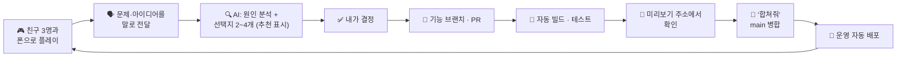

# 뽀득뽀득 목욕탕 기획 기록

AI 코딩 에이전트(Claude Code)와 함께 만든 픽셀 거품 플랫포머 게임의 기획 기록입니다.
코드는 AI가 썼습니다. 저는 친구들과 직접 플레이하면서 문제를 찾았고, 선택지를 받아 결정했고, 미리보기로 확인한 뒤 병합(곧 배포)을 정했습니다.
결정마다 **문제 → 선택지 → 결정과 이유 → 결과** 순서로 남겼습니다.

> 날짜는 한국 시간 기준입니다. 따옴표 안의 말은 대화, 선택지, 게임 화면의 원문을 맞춤법까지 그대로 옮겼습니다.
> 수치는 PR과 설계 문서에 남은 시뮬레이션·측정 결과만 썼습니다. 사용자 수 같은 지표는 지어내지 않았습니다.

---

## 한눈에 보기

| | |
|---|---|
| **무엇** | 비누 거품으로 때 몬스터를 가두는 픽셀 목욕탕 아케이드. 동물 6마리, 탕 24개와 보스, 최대 4명 온라인 협동·배틀, 트로피 리그, 상점·뽑기, 친구 순위 |
| **기간** | 2026-09-30 첫 미니게임 → 10-12 이 게임으로 전환 → 10-19 GitHub와 자동 배포 시작 → 10-27 현재 (파티 모드 작업 중) |
| **내 역할** | 1인 기획자. 문제 발견, 우선순위, 의사결정, 플레이테스트, 병합 결정, 외부 서비스 설정(Firebase 프로젝트 만들기, 중계 서버 가입, GitHub 비밀값 입력) |
| **만든 방식** | 설계 문서, 구현, 테스트는 AI 에이전트가 맡았습니다. 저는 말로 문제와 방향을 주고, AI가 낸 선택지에서 고르거나 새 방향을 냈습니다 |
| **테스트한 사람** | 저와 친구 3명, 각자 폰으로 |
| **규모** | 합친 PR 18개 (10-19 ~ 10-26), 선택지 질문 13번 (질문 21개), 기능 설계 문서 8개 (+ 작업 중 1개), 자동 테스트 240여 개 |
| **링크** | [▶ 웹에서 플레이](https://bubble-c3ad4.firebaseapp.com) · [저장소](https://github.com/bobo33772-blip/Bubble-game) · [설계 문서](../design/) · [PR 목록](#부록-pr-목록) |

### 핵심 결정 6가지

| 날짜 | 판단 | 상황 | 결정 | 출처 | 결과 |
|---|---|---|---|---|---|
| 10-12 | 방향 | "보글보글 저작권에 살짝 걸릴것같은데" | 이름·배포처 질문에 답하기 전에, 원작과 다른 점을 "온라인에서 친구랑 같이하는 게임"으로 정함 | 내 아이디어 | 최대 4명 온라인 협동·배틀 |
| 10-19 | 프로세스 | 추천안은 "친구들과 해 보고 알려주기"(작업 멈춤) | "일단 배포하고 나중에 고쳐도 반영되게". 이어서 브랜치 → PR → 미리보기 → 병합 → 자동 배포 흐름을 제안 | 내 아이디어 (추천과 다르게) | [#1](https://github.com/bobo33772-blip/Bubble-game/pull/1). 이후 PR 17개가 모두 이 흐름을 탐 |
| 10-20 | 우선순위 | 홈 화면 앱이 세로로 열리고, 화면이 작고, 두 번 터치하면 확대됨 | 진행 중이던 친구 기능보다 먼저: "일단 이거 먼저 우선적으로 반영해줘" | 내 우선순위 | [#5](https://github.com/bobo33772-blip/Bubble-game/pull/5), 같은 날 병합 |
| 10-20 | 숫자로 본 트레이드오프 | 판돈이 보상보다 커서, 실력이 같아도 40%가 한 번은 트로피 0개 (시뮬레이션) | B안: 처음 선물 100, 등수 점수 상향, 판마다 +5. A안(모두 2.5배)은 0개 문제가 남아 제외 | 제안 중 선택 | [#4](https://github.com/bobo33772-blip/Bubble-game/pull/4). 강한 친구 상대로 0개가 되는 사람 70% → 24% |
| 10-21 | 악용 방지 | 로그인 안 한 손님도 온라인에서 트로피를 걸 수 있음 | 손님은 온라인 불가, 혼자 하기는 그대로: "같은 사람이 트로피 거는거 조작할수도있으니가" | 내 아이디어 | [#9](https://github.com/bobo33772-blip/Bubble-game/pull/9) |
| 10-26 | 타깃 사용자 · 범위 나누기 | "이 게임 리텐션이 부족해... 뭔가 좀 하다보면 질린다고 해야하나" | 추천안(오늘의 미션 + 출석) 대신 친구용 파티 모드: 팀 프로젝트 쉬는 시간에 팀원끼리 함께 할 게임. 보상은 코인만, 작업은 PR 둘로 나눔 | 제안 중 선택 (추천과 다르게) | 진행 중 ([#20](https://github.com/bobo33772-blip/Bubble-game/pull/20) · PR B) |

---

## 일하는 방식

### 한 사이클

- **문제는 놀면서 찾았습니다.** 요청 대부분이 직접 해 보고 느낀 불편에서 나왔습니다. 홈 화면 앱이 세로로 열리는 것, "벽돌이 막혀서 내려가는게 없으니까 답답해" 같은 것들입니다.
- **결정은 선택지로 했습니다.** AI가 원인과 함께 2~4개 안을 장단점, 추천 표시와 같이 냈습니다. 질문 21개 가운데 13개는 추천안을 그대로 골랐습니다. 3개는 추천과 다른 안을 골랐고, 2개는 답하지 않고 방향을 바꿨습니다. 나머지 3개는 추천이 없는 질문이거나 추천에 하나를 더한 답입니다. 제품 방향을 바꾼 결정은 추천을 따르지 않은 쪽에서 나왔습니다 (아래 표).
- **병합 시점은 제가 정했습니다.** PR마다 미리보기 주소가 붙어 직접 확인할 수 있었고, 대부분의 PR은 제가 "합쳐줘"라고 하면 합쳐졌습니다.

### 추천안과 다르게 고른 순간

| 날짜 | 질문 | 추천안 | 내 선택 | 이유 (기록에 남은 말) |
|---|---|---|---|---|
| 10-12 | 게임 이름, 배포처 | 뽀득뽀득 목욕탕, Claude 공개 링크 | 답하지 않고 방향 전환 | "이걸로 바꾸자 온라인에서 친구랑 같이하는 게임으로. 배틀 형식도 가능하고 같이 보스전 잡는것도 가능하고" |
| 10-16 | 트로피를 어떻게 저장할까 | Claude 계정으로 저장 | 구글 로그인 (배포판만) | 말로 남긴 이유는 없습니다. 10-12 "배포도 하고싶은데", 10-14 "Claude 밖에서 배포하려면 어떻게 해야해.?"와 같은 방향입니다. 추천안은 Claude 링크 안에서만 저장하는 방식이었습니다 |
| 10-19 | 다음으로 뭘 진행할까 | 친구들과 해 보고 알려주기 | 배포 준비 | "그 일단 배포하고 나중에 고쳐도 반영되게" |
| 10-26 | 리텐션을 위해 무엇부터 | 오늘의 미션 + 출석 | 파티 모드 (친구용) | "팀원끼리 쉬는시간에 같이 시간을 떄우며 플레이를 하면 재밌을 것 같아서" (10-27에 덧붙인 설명), "마리오파티게임 처럼" |
| 10-26 | 파티 첫 버전 미니게임 (2~3개 권장) | 물 차오르기, 왕관 뺏기 | 두 개 + 거품 축구 | 따로 남긴 말은 없습니다. 권장 개수 안에서 하나를 더 골랐고, 거품 축구는 나중에 PR B로 나눴습니다 |

### 품질 관문

- PR마다 자동 '테스트' 검사가 돌고, 통과해야 main에 합칠 수 있습니다 ([#1](https://github.com/bobo33772-blip/Bubble-game/pull/1)).
- PR마다 Firebase 미리보기 주소(7일 유지)가 댓글로 달립니다. 미리보기에서 한 기록은 운영 기록과 따로 저장됩니다.
- 서버 보안 규칙(Firestore)이 바뀌는 PR은 규칙을 먼저 배포한 다음 합칩니다 ([#4](https://github.com/bobo33772-blip/Bubble-game/pull/4), [#7](https://github.com/bobo33772-blip/Bubble-game/pull/7), [#9](https://github.com/bobo33772-blip/Bubble-game/pull/9), [#15](https://github.com/bobo33772-blip/Bubble-game/pull/15)).
- 숫자가 걸린 기능은 설계 단계에서 먼저 시뮬레이션했습니다. 트로피 밸런스가 그랬고, 동물별 탄창은 동물 쌍마다 봇 대결을 192판씩 돌렸습니다.
- 전체 테스트(헤드리스 크롬, 240여 개)는 릴리스마다 한 번 돌립니다. 테스트 중에는 소리도 끄게 했습니다 (10-18, "작업하는데 소리는 끄고 해줘. 계속 백그라운드에서 소리가 울리네").

### 비용 관리 `내 아이디어`

- **AI 사용량:** 10-19 새벽에 "토큰 너무 많이쓰는데 최적화해서 좀 적게 써봐"라고 요청했습니다. 그때까지는 변경 하나에 에이전트 6개와 리뷰어 3명을 썼습니다. 이후로는 작업 하나에 에이전트 하나가 기본이고, 많아도 2~4개입니다. 리뷰 패널은 없고, 전체 테스트는 릴리스마다 한 번입니다. 10-20에도 "토큰 절약해서 해줘"라고 한 번 더 요청했습니다.
- **선택지에 비용이 같이 적혀 왔습니다.** 예를 들면 "토큰이 가장 적게 들어요", "토큰이 꽤 들어요(2~3시간)" 같은 식입니다.
- **인프라:** Firebase는 무료 요금제(Spark)를 씁니다. 중계 서버는 무료 사용량(월 50GB)이 있는 요금제이고, 자동 충전은 꺼 뒀습니다.

---

## 결정 기록

출처 표시:
- `내 아이디어`: 해결책이나 방향을 제가 먼저 냈습니다
- `내 요청`: 문제나 원하는 것을 제가 말했고, 원인 분석과 구체적인 설계는 AI가 했습니다
- `제안 중 선택`: AI가 낸 선택지에서 제가 골랐습니다. 추천과 다르게 고른 경우는 따로 적었습니다
- `내 우선순위`: 무엇을 먼저 할지 제가 정했습니다

### 1. 시작과 방향 전환

#### 09-30 ~ 10-02 · 떡 미니게임 (출발점)
"킬링타임용 미니게임 하나 만들어줘"로 떡 미니게임을 만들었습니다. 이때도 피드백은 직접 해 본 손맛이었습니다: "떡질감이 느껴지게", "연속 완벽하면 점수가 더 잘 오른다는듯이".

#### 10-12 · 버블버블 같은 게임 → 저작권 → 온라인 친구 게임 `내 아이디어`
- **왜 이 게임인가 (10-27에 덧붙인 설명):** 거창한 이유가 아니라 "직관적으로 시간 때우기용 게임이 있으면 좋겠다 생각해서" 시작했습니다. "옛날 오락실에서 하던 게임들이 전부 다 하기 쉬운데 재밌는게임들이 많았어서", 그중 보글보글을 떠올려 비슷한 조작과 재미를 기준으로 삼았습니다. 배우지 않아도 바로 할 수 있는 것이 처음부터 목표였습니다.
- **문제/관찰:** "버블버블 같은 게임"으로 새로 시작해 보스전과 배포까지 원했습니다. 그러다 제가 먼저 문제를 짚었습니다: "보글보글 저작권에 살짝 걸릴것같은데 다른 재밌는 요소 추가해도 좋을 것 같아".
- **선택지:** AI는 이름 3안(뽀득뽀득 목욕탕 (추천) · 꽥꽥이의 목욕탕 대청소 · 때 빼고 광 내고)과 배포처 4안(Claude 공개 링크 (추천) · itch.io · GitHub Pages · 파일만 받기)을 물었습니다.
- **결정과 이유:** 질문에 답하지 않고 방향을 바꿨습니다: "이걸로 바꾸자 온라인에서 친구랑 같이하는 게임으로. 배틀 형식도 가능하고 같이 보스전 잡는것도 가능하고". 원작과 달라야 한다는 문제를 이름만이 아니라 플레이 방식으로 풀었습니다.
- **결과:** 최대 4명이 하는 온라인 '같이 하기'(협동)와 '배틀'(대전)이 생겼습니다. 이름과 목욕탕 세계관(때 몬스터, 냉탕·온탕·사우나)은 AI가 가제로 쓰던 '뽀득뽀득 목욕탕'이 그대로 이어졌습니다.
- **후속:** 같은 날 "오리 뿐 만아니라 다른 귀여운 동물캐릭터도 만들어줘"라고 요청했고, 지금은 동물이 6마리입니다.

### 2. 핵심 게임

#### 10-14 · 동물마다 확실히 다르게 `내 요청`
- **문제/관찰:** "각 캐릭터만의 특징이 좀 더 차별화 되었으면 좋겠어. 지금 별로 다 비슷해보여". 실제로 여섯 동물의 차이는 카피바라 걷기 0.92배, 고양이 점프 1.08배, 개구리 연사 간격 0.7배 정도뿐이었습니다 ([design/char-kits.md](../design/char-kits.md)).
- **AI 설계와 이유:** AI가 동물마다 두 설계안을 비교했습니다. 예를 들어 개구리는 '더 빠른 연사' 대신 '앞에 멈춰 기다리는 개구리알 함정'이 됐습니다. 빠른 연사는 원래 능력을 키운 것뿐이라, 제가 말한 "다 비슷해보여"가 그대로 남기 때문입니다. 동물마다 다른 특기와 다른 거품을 주되, 가르칠 규칙은 "특기는 점프 버튼" 하나로 줄였습니다.
- **결과:** 만능, 든든, 돌격, 저격, 곡예, 함정의 6가지 역할이 생겼습니다 ([README 동물 표](../README.md#동물-친구들)). GitHub 이전이라 Claude 아티팩트 버전에 반영됐습니다.
- **후속:** 같은 날 "고양이 귀가 삐뚤어졌어. 그리고 더 귀엽게 해줘"로 그림을 다듬었습니다. 10-23 배틀 장전 작업([#13](https://github.com/bobo33772-blip/Bubble-game/pull/13))에서 동물별 차이를 한 번 더 키웠습니다.

#### ~10-16 · 같이 할 때 누가 누군지 헷갈림 `내 요청`
- **문제/관찰:** 설계 문서에 남은 요청은 "같이 하기 할 때 사용자 구분이 잘 가게 해줘 너무 헷갈려"와 "배틀에는 몬스터 출현 체크 박스 만들어줘"입니다 ([design/distinction.md](../design/distinction.md)).
- **AI 설계와 이유:**
  - 자리 색 4개는 그대로 두고, 모든 곳에 번호(1P~4P)를 붙였습니다. 색만으로 구분하면 색약이 있는 친구는 쓸 수 없기 때문입니다.
  - 같은 동물을 여러 명이 고르면, 두 번째부터는 몸 색을 자기 자리 색으로 바꿉니다(쌍둥이 색). 크레이지 아케이드처럼 한눈에 구분됩니다.
  - 내 이름표에는 '나'를 붙였습니다.
  - 배틀 방에 '몬스터 출현' 옵션을 넣었습니다(기본 켬).
- **결과:** 아티팩트 v5 (10-19).
- **후속:** 10-23 "같은캐릭터중복으로하면 인게임에서 캐릭터가 깨질때가있어" → [#17](https://github.com/bobo33772-blip/Bubble-game/pull/17) (8. 배틀 품질).

#### 10-20 ~ 10-23 · 작은 요청들 `내 요청`
- "혼자하기 목숨 하나 추가해줘 기본 4개로" (10-20) → 목숨 3개 → 4개 ([#3](https://github.com/bobo33772-blip/Bubble-game/pull/3)).
- "개굴 깨굴로 이름 바꿔주고" (10-23) → 개구리 이름이 깨굴이, 특기 이름이 '깨굴 3단 뛰기'가 됐습니다 ([#13](https://github.com/bobo33772-blip/Bubble-game/pull/13)).
- "밑에 방향키누르면 밑으로내려가게 해줘 벽돌이 막혀서 내려가는게 없으니까 답답해" (10-23) → ↓/S 키나 조이스틱을 아래로 당기면 발판 아래로 내려갑니다 ([#14](https://github.com/bobo33772-blip/Bubble-game/pull/14), 10-26 병합).

### 3. 배포·인프라

#### 10-14 · Claude 밖에서 배포하려면? `내 요청`
- "Claude 밖에서 배포하려면 어떻게 해야해.?" → AI가 배포용 한 장짜리 파일과 올리는 방법(GitHub Pages, Netlify, Cloudflare Pages, itch.io)을 정리했습니다.
- 이 안내에 이미 위험 메모가 있었습니다. 회사·학교 와이파이나 통신사망에서는 기기끼리 직접 연결이 막힐 수 있어, 안정적으로 하려면 중계(TURN) 서버가 필요하다는 내용입니다. 이 위험은 10-21에 실제로 터졌습니다 (아래, 그리고 회고).

#### 10-16 · Claude 링크로는 친구가 방에 못 들어옴 `내 요청`
- **문제:** "클로드아티팩트 링크로 같이하려는데 방만들고 코드 쳐서 들어가려고 해도 방을 찾을 수 없다고 나와".
- **원인:** Claude 아티팩트의 방은 공유 메뉴에서 이메일로 초대받고 로그인한 사람만 쓸 수 있습니다. 공개 링크로 들어온 사람은 쓸 수 없습니다.
- **결과:** 틀린 안내인 '방을 찾을 수 없어요' 대신 진짜 이유를 바로 보여 줍니다: "이 링크로는 친구와 하기를 쓸 수 없어요 · 방장에게 이메일 초대를 부탁해요". 아무도 못 들어오는 방은 아예 만들 수 없게 했습니다 ([design/distinction.md](../design/distinction.md)).

#### 10-19 · "일단 배포하고 나중에 고쳐도 반영되게" `내 아이디어`
- **상황:** 0시 무렵에는 "배포는 기능이 다 정해진 뒤에 해요"라는 추천안('나중에')을 골랐습니다. 같은 날 저녁에 다음 작업 선택지가 왔습니다: 친구들과 해 보고 알려주기 (추천) · 동물별 실력 차이 맞추기 · 배포 준비.
- **결정과 이유:** 배포 준비를 골랐습니다. "그 일단 배포하고 나중에 고쳐도 반영되게". 바로 이어서 "깃허브에 먼저 연결하고 main이랑 firebase연결가능한가? 그러면 main고칠때 재배포 해서 계속계속 업데이트가 가능하잖아"라고 했습니다. 다 만든 뒤 배포하려던 생각을 하루 만에 바꿔, 먼저 배포하고 계속 고치는 쪽으로 정했습니다.
- **선택지 (배포처):** GitHub Pages 먼저 (추천: 지금 바로 되고 비밀 키가 필요 없음) / Firebase 호스팅 (프로젝트와 배포 키를 먼저 준비해야 함). GitHub Pages 먼저를 골랐습니다.
- **결과:** 10-19 저녁에 저장소에 첫 커밋을 올렸고, main에 올리면 GitHub Pages에 자동 배포되게 했습니다.

#### 10-19 · 브랜치 → PR → 미리보기 → 병합 → 자동 배포 `내 아이디어`
- **제안:** "기능 브랜치 → PR → 자동 빌드·테스트 → Preview 확인 → main 병합 → 운영 자동 배포 이 흐름으로 가는게 좀 더 안정적이고 괜찮을 것 같은데 어때".
- **결과:** [#1](https://github.com/bobo33772-blip/Bubble-game/pull/1) (10-20 병합). PR마다 자동 테스트가 돌고(통과해야 병합), Firebase 미리보기 주소가 댓글로 달리고, 병합하면 운영에 자동 배포됩니다. #2부터 #18까지 전부 이 흐름을 탔습니다.
- **후속:** 이 흐름이 생긴 뒤로는 작게 합치고 바로 고쳤습니다: "만든기능은 main에 합쳐줘. 나중에 확인하고 다시 수정할수있지?" (10-20).

#### 10-19 ~ 10-20 · Firebase 연결 `내 요청`
- "나중에 사용자 가입이랑 로그인 기능도 만들게 파이어베이스로 배포해줄래" → Firebase 프로젝트는 제가 직접 만들었고, AI가 화면마다 안내했습니다.
- 설정하면서 두 가지를 물었습니다. "realtime database가 맞아? 서울 리젼이 없는데", 그리고 "나중에 AI기능도입할수도있는데 그러면 나중에 바꿀수있어?". 데이터베이스는 서울 리전(asia-northeast3)의 Firestore로 정했습니다.
- **결과:** 10-20부터 main에 합치면 운영 주소 [bubble-c3ad4.firebaseapp.com](https://bubble-c3ad4.firebaseapp.com)과 GitHub Pages에 함께 자동 배포됩니다.

#### 10-21 · 다른 네트워크끼리는 연결이 안 됨 → 중계 서버 `내 요청`
- **문제:** "이거 같이하기 코드 쳐도 연결이 안되는데 이거 먼저 확인해줘", "같은 링크주소로 들어갔고 연결하는중일고 떴어".
- **원인 (AI 분석):** 폰 데이터와 다른 집 와이파이처럼 서로 다른 네트워크끼리는 직접 연결이 자주 막힙니다. 그래서 중계(TURN) 서버가 필요한데, 기본으로 쓰던 무료 중계 서버가 응답하지 않았습니다(중계 후보 0개).
- **결정과 이유:** 새 서버를 붙이기 전에 정말 필요한지부터 확인했습니다: "아 코드치거나 친구랑 같이하기 하려면 또 서버가 필요해?". 필요하다는 것을 확인한 뒤, 중계 서비스(Metered, 서울 리전)에 직접 가입해 설정값을 GitHub 비밀값으로 넣었습니다.
- **결과:**
  - [#6](https://github.com/bobo33772-blip/Bubble-game/pull/6): 중계 서버 설정을 넣을 자리를 만들었습니다. 연결에 실패하면 "친구 기기와 연결하지 못했어요 · 같은 와이파이에서 해 보거나 잠시 뒤 다시 해 주세요"라고 안내합니다.
  - [#8](https://github.com/bobo33772-blip/Bubble-game/pull/8): 서비스가 주는 형식을 그대로 붙여 넣어도 읽히게 했습니다.
  - 배포 페이지에서 서울 중계 서버가 잡히는 것을 확인했습니다.

#### 10-23 · 저장소 첫인상 `내 아이디어`
"깃허브에 딱 처음 들어가서 볼 때 이게 무슨게임인지 알게하고싶은데 readme .md 그거 내 다른 레포짓처럼 해서 만들어줘 이미지도 있으면 좋고" → 게임 소개, 화면 사진, 동물 표, 플레이·개발 흐름도를 담은 README를 만들었습니다 ([#12](https://github.com/bobo33772-blip/Bubble-game/pull/12)).

### 4. 계정·로그인

#### 10-16 · 트로피를 저장하려면 로그인이 필요할까 `제안 중 선택 (추천과 다르게)`
- **질문:** "그러면 자신의 트로피같은게 저장되려면 로그인 같은 기능이 있어야하나 아니면. 그래야 좀 트로피 개수가 저장되어야하지 않나. 아니면 다른 방법이 있나".
- **선택지:**
  - Claude 계정으로 저장 (추천): 바로 만들 수 있지만 Claude 링크에서만 됨
  - 둘 다
  - 구글 로그인 (배포판만): "Claude 계정 없는 친구도 OK". 대신 Firebase 프로젝트를 직접 만들어야 함
  - 옮기기 코드: 가장 간단하지만 자동 저장이 아니고 조작이 쉬움
- **결정과 이유:** 구글 로그인 (배포판만). 말로 남긴 이유는 없지만, 처음부터 원했던 'Claude 밖 배포'와 같은 방향입니다.
- **설계에서 정한 것 (AI):**
  - 게임 기록에는 구글 이름과 메일을 넣지 않습니다.
  - 오프라인에서도 플레이할 수 있습니다.
  - 공개 순위표는 첫 버전에서 뺐습니다. 모르는 사람의 닉네임을 검수 없이 보여 주게 되기 때문입니다.
- **결과:** 10-16에 구현했고, Firebase를 연결한 10-20에 실제로 켜졌습니다. '모르는 사람에게 기록을 보이지 않는다'는 원칙은 10-20 친구 기능의 요청·수락 방식으로 이어졌습니다.

#### 10-20 · 로그인부터 시작하는 화면 `내 요청`
- **요청:** "안전장치 진행해주고, 화면 흐름을 로그인부터 할 수 있게끔 바꾸자. 로그인화면을 만들자는거야". 여기서 안전장치는 전날 배포 준비 선택지에 들어 있던 '로그인 저장의 남은 안전장치'입니다.
- **다듬은 과정:** PR 미리보기를 보면서 20여 분 동안 네 번 고쳤습니다.
  1. "구글로 시작하기 버튼 색깔을 디자인에 좀 맞게 바꿔주고 구글 로고를 넣어서해줘"
  2. "흰색으로 만들어줘 버튼 배경색을"
  3. "문구 다른걸로 바꿔주고 구글로 시작하기 버튼 자연스럽게 바꿔줘"
  4. "로그인 트로피 이런내용 빼고 그냥 게임 테마에 맞는 디자인"
- **결과:** [#2](https://github.com/bobo33772-blip/Bubble-game/pull/2). 첫 화면에서 설명문을 빼고 목욕탕 분위기만 담았습니다: 탕 속 동물 여섯 마리, "어서 오세요, 손님!", Google로 계속하기 / 손님으로 입장하기. 같은 PR에 저장 안전장치도 넣었습니다. 예전 버전 탭이 클라우드 기록을 덮어쓰지 못하게 하는 장치입니다.

#### 10-21 · 손님은 온라인 불가 `내 아이디어`
- **관찰:** 로그인하지 않은 '손님'도 온라인에서 트로피를 걸 수 있었습니다. 친구 목록에서 바로 초대하는 기능을 요청한 같은 메시지에서 이 문제를 짚었습니다.
- **결정과 이유:** "손님으로 하기 했을때는 같이하기 못하기로하는게 나을 것 같아 왜냐면 같은 사람이 트로피 거는거 조작할수도있으니가". 계정이 없으면 한 사람이 손님 창을 여러 개 열어 자기에게 트로피를 몰아줄 수 있습니다.
- **남겨 둔 것:** 혼자 하기는 손님도 그대로 할 수 있습니다. 막은 건 온라인뿐입니다. 손님이 초대 링크를 열면 로그인한 뒤 그 방으로 바로 이어집니다.
- **앞 결정과의 연결:** 전날(10-20) 부전승 악용 막기를 정할 때 "트로피 모으려면 계정도 2개있어야하니까"라고 답했습니다. 계정 없이 들어오는 손님이 온라인을 할 수 있으면 이 전제가 깨집니다. 이 결정으로 '트로피는 진짜 계정끼리만'이 지켜졌습니다.
- **결과:** [#9](https://github.com/bobo33772-blip/Bubble-game/pull/9) (10-22 병합).

### 5. 경제·밸런스

#### 10-14 · 트로피: 내 점수, 그리고 걸고 하는 재미 `내 요청`
- **요청:** "뭔가 트로피 같이 자신의 점수? 뭐 그런게 있었으면 좋겠어. 예를들어 루미큐브보면 트로피 있잖아. 친구랑 게임할때도 몇개 걸고 막 하고 이런식으로".
- **결과:** 트로피 첫 버전. 리그(때밀이 견습 → 목욕탕 왕)가 생겼고, 배틀에서 판돈을 걸고 등수대로 트로피를 주고받습니다. 아티팩트 버전에 반영했습니다 ([design/trophies.md](../design/trophies.md)).

#### 10-16 · 상점·마이페이지, 그리고 화폐 분리 `제안 중 선택`
- **요청과 이유:** "트로피로 약간 캐릭터에 착용할 수 있는 아이템 살 수 있게 해줬으면 좋겠어. 상점과 마이페이지를 만드는거지. 크레이지 아케이드 게임 알지 그런것처럼 그래ㅐ야 사람들이 계속해". 꾸미기를 '계속할 이유'로 본 첫 리텐션 판단입니다.
- **선택지:** 트로피 + 비누 코인 따로 (추천) / 트로피로 직접 구매 (걸 수 있는 트로피가 줄어듦) / 트로피로 잠금 해제.
- **결정과 이유:** 트로피 + 비누 코인 따로. 트로피는 지금처럼 등급과 내기에 쓰고, 코인은 이기든 지든 혼자 하든 플레이하면 쌓입니다. 트로피를 쓰게 하면 내기에 걸 트로피가 줄어듭니다.
- **설계 원칙 (AI):** 코인은 플레이로만 얻고 돈으로 팔지 않습니다. 아이템은 물리, 판정, 점수 등 플레이에 전혀 영향을 주지 않습니다. 첫 아이템까지 약 10분이 목표입니다 ([design/shop.md](../design/shop.md)).
- **결과:** 아이템 40개, 아티팩트 v5 (10-19).

#### 10-19 · 동물마다 따로 입히기 + 뽑기 `내 요청` · `제안 중 선택`
- **요청:** "이거 아이템 착용하면 모든 캐릭터가 착용되지말고 그 캐릭터에만 착용하게 해줘. 다른캐릭터에는 따로 또 착용할 수 있게끔 그리고 상점안에 뽑기 기능도 만들어줘".
- **선택지 (뽑기에서 나올 아이템):** 전용 + 기존 섞기 (추천, 가장 오래 걸림) / 상점 아이템만 (가장 빠름) / 뽑기 전용 아이템만.
- **결정:** 전용 + 기존 섞기.
- **AI가 정한 규칙:**
  - 이미 입던 옷은 여섯 동물 모두에 복사해, 아무도 지금 모습을 잃지 않게 했습니다.
  - 뽑기 확률은 화면에 공개합니다.
  - 원하는 상점 아이템은 뽑기보다 바로 사는 쪽이 항상 쌉니다.
  - 결과는 애니메이션보다 먼저 저장해, 새로고침해도 다시 뽑히지 않습니다.
  - 이미 가진 아이템이 나오면 코인 일부를 돌려줍니다.
- **결과:** 1회 200코인, 뽑기 전용 아이템 10종. 아티팩트 v6·v7 (10-19)이 GitHub 이전의 마지막 버전입니다 ([design/looks-per-animal.md](../design/looks-per-animal.md), [design/gacha.md](../design/gacha.md)).

#### 10-20 · 트로피 밸런스 B안 `제안 중 선택`
- **문제:** "지금 트로피를 너무 쪼금 주는데 배틀이나 그럴때 트로피를 걸고 하잖아. 이거 밸런스 맞춰야할것같아".
- **진단 (설계 문서의 시뮬레이션):** 1등이 받는 건 많아야 +14인데 판돈은 50까지 걸 수 있었고, 처음 선물은 30이었습니다. 실력이 같아도 배틀의 9%가 판돈이 모자라 막혔고, 40%의 사람이 한 번은 0개가 됐습니다.
- **선택지:**
  - B안 (추천): 처음 선물 100, 4명 기준 1등 +16 · 2등 +8 · 3등 +2 · 4등 −6, 판마다 +5 (하루 40까지)
  - A안: 모든 보상과 손해를 2.5배. 단순하지만 지면 잃는 것도 커져서 0개 문제가 남음
  - C안: 리그 기준만 절반으로. 걸기 문제는 그대로
  - 같이 고칠 것: 부전승 악용 막기 / 트로피가 모자라면 안 걸고 참여
- **결정과 이유:** B안. 선택지 설명대로라면 0개 문제와 막히는 판을 둘 다 푸는 안은 B안뿐이었습니다. 같이 고칠 것에는 "그냥 해 이것도 트로피 모으려면 계정도 2개있어야하니까"라고 답했고, 두 가지 모두 들어갔습니다.
- **결과:** [#4](https://github.com/bobo33772-blip/Bubble-game/pull/4) (같은 날 병합).
  - 부전승은 판돈만 받습니다.
  - 트로피가 모자란 친구는 안 걸고 참여하니, 방이 막히지 않습니다.
  - 판마다 주는 +5가 지는 사람을 0개에서 지켜 줍니다. 강한 친구를 상대로 한 시뮬레이션에서 0개가 되는 사람이 70%에서 24%로 줄었습니다.
- **후속:** 트로피가 8개 밑으로 안 줄어드는 현상 (바로 아래).

#### 10-23 → 10-26 · 트로피가 8개 밑으로 안 줄어듦 `제안 중 선택`
- **문제:** "트로피가 8개 이하로 안줄어드는 버그".
- **원인:** 버그가 아니었습니다. 견습(60개 미만) 보호, 모자라면 안 걸고 참여, 판마다 +5가 겹쳤습니다. 판돈 5개로 져도 −5 다음에 +5가 들어와 다시 8개가 됐습니다.
- **선택지:**
  - 꼴등은 +5 없음 (추천)
  - 안 걸고 참여해도 등수 손해는 받음
  - 신입 보호 기준을 60개 미만에서 30개 미만으로
  - 지금처럼 두기 (일부러 만든 보호이므로)
- **결정과 이유:** 꼴등은 +5 없음. 지면 확실히 줄어들고, 신입 보호는 그대로 남습니다.
- **결과:** [#17](https://github.com/bobo33772-blip/Bubble-game/pull/17) (10-26). 8개에서 판돈 5개를 지면 이제 3개가 됩니다. 꼴등이 여러 명이면 모두 못 받고, 무승부면 모두 받습니다.

### 6. 소셜

#### 10-20 · 친구 순위로 경쟁심 `내 아이디어` · `제안 중 선택`
- **아이디어:** "추가로 친구추가 기능 만들어서 혼자하기에서 몇스테이지까지 갔는지 그런게 있으면 좋을것같아 경쟁심도 생기고 친구 어디까지 갔나 확인하고".
- **선택지:**
  - 친구 추가 방식: 친구 코드 + 요청·수락 (추천: 모르는 사람이 내 기록을 볼 수 없음) / 코드만 (수락 없이, 코드를 알면 누구나 기록을 봄) / 같이 한 방 친구 자동 추가
  - 보여줄 것 (여러 개): 혼자 하기 최고 스테이지 · 최고 점수 · 트로피·리그 · 대표 동물과 입은 옷
- **결정:** 요청·수락 방식. 더 간단한 '코드만' 대신, 모르는 사람이 내 기록을 못 보는 쪽을 골랐습니다. 보여줄 것은 네 가지 모두.
- **결과:** [#7](https://github.com/bobo33772-blip/Bubble-game/pull/7) (10-21). 8자리 친구 코드로 친구를 맺고, 혼자 하기 최고 스테이지로 순위를 매깁니다 ([design/friends.md](../design/friends.md)).
- **후속:** "친구 기록에서 혼자하기 몇스테이지까지 갔는지로 라운드별로 세서" (10-23) → '최고 29라운드'처럼, 첫 탕부터 센 라운드 수 하나로 보여 줍니다 ([#13](https://github.com/bobo33772-blip/Bubble-game/pull/13)).

#### 10-21 · 친구 목록에서 바로 초대 `내 아이디어`
- **요청:** "응 만들어줘.친구목록에서 바로 초대하는 기능도".
- **결과:** [#9](https://github.com/bobo33772-blip/Bubble-game/pull/9). 친구마다 '초대' 버튼이 생겼습니다. 받은 친구 화면 위에 "같이 하자고 해요" 배너가 뜨고, 코드를 입력하지 않고 바로 참여합니다. 초대는 10분 동안 유효합니다.
- **후속:** "친구초대할때 친구들 초대 계속누르는데 한명 하면 다음 한명이 바로 초대가 안돼 확인해줘" (10-23) → 연달아 초대를 막는 10초 제한이 같은 친구에게만 걸리게 했습니다 ([#15](https://github.com/bobo33772-blip/Bubble-game/pull/15)).

#### 10-23 · 마이페이지에서 친구 찾기 `내 요청`
"이어서 마저 해주고 친구목록을 볼 수 있게 마이페이지나 그런거에서 만들어줘" → 마이페이지 아래에 '친구' 버튼을 달았습니다. 요청이나 초대가 오면 빨간 점이 뜹니다 ([#11](https://github.com/bobo33772-blip/Bubble-game/pull/11)).

### 7. 모바일 UX

#### 10-16 · 폰에서도 하고 싶다 `제안 중 선택`
- **요청:** "그리고 핸드폰에서도 플레이 하고싶은데".
- **선택지:** 홈 화면 앱처럼 만들기 (추천, PWA) / 지금 그대로 / 앱스토어 앱도 준비 (개발자 계정 비용 별도).
- **결정:** 홈 화면 앱처럼 만들기. 아이콘을 누르면 전체 화면으로 열리고, 오프라인에서도 혼자 하기가 됩니다.
- **후속:** 10-20에 실제로 홈 화면에 추가해 써 보다가 세로 화면 문제를 찾았습니다 (바로 아래).

#### 10-20 · 가로 고정, 꽉 찬 화면, 확대 막기, 조이스틱 `내 우선순위`
- **관찰:** "현재 모바일로 하려고 웹앱으로 홈화면 추가해서 하면 세로화면으로 나와서 사용자가 돌려야 하거든. 정말 게임처럼 가로로 돌리게 고정해주고". 직접 해 보며 찾은 문제가 셋 더 있었습니다.
  - 가로로 돌려도 화면이 작음
  - 두 번 터치하면 화면이 확대돼 게임에 방해됨
  - 화살표 대신 조이스틱으로 움직이고 싶음
- **결정과 이유:** "일단 이거 먼저 우선적으로 반영해줘". 30분 전에 정한 친구 기능보다 앞에 뒀습니다. 폰으로 열 때마다 "사용자가 돌려야" 하는 불편을 새 기능보다 먼저 없애기로 했습니다.
- **결과:** [#5](https://github.com/bobo33772-blip/Bubble-game/pull/5) (같은 날 저녁 병합). 가로 고정, 폰마다 맞춰지는 화면 크기, 두 번 터치 확대 막기, 왼쪽 엄지 조이스틱.
- **후속:** 작은 창에서 아래 조작법 줄이 3줄로 늘어나 게임 화면이 줄어드는 문제를 [#18](https://github.com/bobo33772-blip/Bubble-game/pull/18)에서 고쳤습니다 (10-26).

### 8. 배틀 품질

#### 10-22 · 맞았는데 안 잡힘 `내 요청`
- **문제와 제안:** "배틀 모드에서 서로서로 이거 정확도가 좀 낮은데 이거 정확도랑 확실하게 해주고, 한번에 쏠수있는개수 정해야 좀 안 복잡할것같아". 개수 제한은 화면이 복잡하다는 제 생각에서 나왔습니다.
- **원인 (AI 분석):** 맞았는지를 '맞은 사람 화면' 기준으로 판정했습니다. 통신 지연 때문에 쏜 사람이 보는 화면과 0.3~0.7초씩 어긋났습니다. 판정 원도 그려진 거품보다 2~5px 작았습니다.
- **AI 설계:** 쏜 사람 화면에서 맞았으면 맞은 것으로 칩니다. 호스트가 최대 0.5초까지 되감아 확인합니다. 판정 원은 보이는 크기와 같게 했고, 한 번에 날아가는 거품은 3개까지로 정했습니다.
- **결과:** [#10](https://github.com/bobo33772-blip/Bubble-game/pull/10). 봇 3명, 지연 120ms로 측정했습니다.
  - 눈으로는 닿았는데 판정이 안 된 경우: 20% → 0%
  - 안 닿았는데 잡힌 경우: 17% → 9%

#### 10-22 → 10-23 · "배틀 거품 갯수 반영이 안된것같은데" `제안 중 선택`
- **관찰:** [#10](https://github.com/bobo33772-blip/Bubble-game/pull/10)을 합치고 10분 뒤에 해 보니 제한이 걸린 것 같지 않았습니다. 날아가는 거품만 3개로 셌기 때문에, 떠 있는 거품은 계속 쌓였습니다.
- **선택지:**
  - 제한 개수에서 또 누르면: 가장 오래된 거품이 터지고 새로 나감 (추천: 덜 답답함) / 크레이지 아케이드처럼 못 쏨 (전략적이지만 기다리는 시간이 생김)
  - 한 사람당 개수: 3개 (추천) / 2개 / 4개
- **결정:** 가장 오래된 거품이 터지는 방식. 날아가는 것과 떠 있는 것을 합쳐 3개.
- **결과:** [#11](https://github.com/bobo33772-blip/Bubble-game/pull/11) (10-23).

#### 10-23 · 장전과 동물별 차이 `내 요청`
- **요청:** "배틀할때 3개씩 나오긴하는데 3개 쏘면 2초뒤에 쏠 수 있게 해줘. 그리고 이거에 맞게 동물별로 능력 좀 더 구분가게 해줘".
- **AI 설계:** 동물마다 탄창 수와 장전 시간을 다르게 했습니다 (예: 까삐 2발 · 1.2초, 냥냥 4발 · 2.4초).
- **검증:** 동물 쌍마다 봇 1대1 대결을 192판씩 돌렸습니다. 15쌍 모두 승률이 40~60% 안에 들었습니다. 탄창이 없을 때는 해롱이가 깨굴이를 73% 이겼습니다.
- **결과:** [#13](https://github.com/bobo33772-blip/Bubble-game/pull/13) (같은 날 병합). 10-19 선택지에서 고르지 않았던 '동물별 실력 차이 맞추기'가 여기서 장전과 함께 이뤄졌습니다.

#### 10-23 → 10-26 · 연사 옵션 `내 우선순위`
- **결정:** "연사작업을 최우선으로 해줘" (10-23). 남은 작업 가운데 연사를 가장 먼저 하게 했습니다.
- **결과:** [#16](https://github.com/bobo33772-blip/Bubble-game/pull/16) (10-26, "연사 작업 되면 바로 합쳐줘"). 배틀 방 설정에 '연사' 체크박스가 생겼습니다. 기본은 꺼짐이고 동물별 장전 규칙을 따릅니다. 켜면 장전 없이 쏩니다. 화면에 있는 내 거품은 모든 동물이 최대 3개입니다.

#### 10-23 → 10-26 · 같은 동물 그림 깨짐 `내 요청`
- **문제:** "같은캐릭터중복으로하면 인게임에서 캐릭터가 깨질때가있어".
- **원인 (AI 분석):** 쌍둥이 색을 칠할 때 화면(캔버스)에서 색을 다시 읽었습니다. 그런데 Safari 26(기본 설정)과 Firefox·Brave의 개인 정보 보호 모드는 캔버스 읽기에 일부러 잡음을 섞습니다. 자동 테스트(헤드리스 크롬)에는 없는 잡음이라, 실제 플레이에서 처음 드러났습니다.
- **결과:** [#17](https://github.com/bobo33772-blip/Bubble-game/pull/17). 그림 원본 픽셀로 칠하게 바꿨습니다. 잡음을 넣은 288개 프레임으로 검사했고, 고치기 전에는 288개 모두 실패했습니다.

### 9. 리텐션

#### 10-16 · 꾸미기는 계속할 이유
상점과 비누 코인 결정(5. 경제·밸런스)이 첫 리텐션 판단이었습니다: "그래ㅐ야 사람들이 계속해".

#### 10-26 · "리텐션이 부족해" `제안 중 선택 (추천과 다르게)`
- **문제:** "다 좋은데 이 게임 리텐션이 부족해... 뭔가 좀 하다보면 질린다고 해야하나 질리지가 않아야하는데 기능이나 게임종류나 그런거 넣을 추천좀 해줘바".
- **선택지 (여러 개 골라도 되고, 고른 순서대로 PR을 올림):**
  - 오늘의 미션 + 출석 (추천): 가장 작고 빠름
  - 무한 목욕탕: 점점 어려워지는 모드, 3탕마다 강화 고르기
  - 파티 모드 (친구용): 1~2분짜리 미니게임을 이어서 하고 점수로 최종 1등
  - 숙련도·도감·칭호
- **결정과 이유:** 파티 모드 하나만 골랐고, "마리오파티게임 처럼"이라고 방향을 덧붙였습니다. 이유 (10-27에 덧붙인 설명): 혼자서도 시간을 때울 수 있지만, 팀 프로젝트를 하던 중이라 "팀원끼리 쉬는시간에 같이 시간을 떄우며 플레이를 하면 재밌을 것 같아서"입니다. 잠깐씩 모이는 쉬는 시간에 맞춰, 짧은 판을 여럿이 함께 하는 모드를 혼자 하는 장치(미션, 무한 모드, 숙련도)보다 먼저 골랐습니다.
- **다음:** 지금 진행 중 (바로 아래).

---

## 지금 진행 중: 파티 모드 (10-26 ~)

같은 날 이어서 세 가지를 선택지로 정했습니다.

| 질문 | 선택지 | 결정 |
|---|---|---|
| 첫 버전 미니게임 (2~3개 권장) | 물 차오르기 (추천) · 왕관 뺏기 (추천) · 거품 축구 · 때 몬스터 많이 잡기 | **물 차오르기 · 왕관 뺏기 · 거품 축구** (추천 둘 + 하나 더) |
| 파티 한 번은 몇 판 | 방장이 3판/5판 고르기 (추천) · 3판 고정 · 5판 고정 | **방장이 3판/5판** |
| 보상 | 비누 코인만 (추천: 배틀 트로피 밸런스를 건드리지 않음) · 트로피도 걸기 | **비누 코인만** |

- **범위 나누기:** 작업을 나눠 올리자는 제안에 "응 나눠서 올려줘"라고 답했습니다.
  - PR A: 파티 흐름 + 물 차오르기 + 왕관 뺏기
  - PR B: 거품 축구
- **규칙 (AI 설계):**
  - 2~4명이 하고, 판마다 순위 점수를 줍니다 (4명이면 4 / 2 / 1 / 0점). 총점으로 최종 1등을 정합니다.
  - 상대를 거품에 가두면 짧게 묶이기만 하고 KO는 없습니다.
  - 코인 악용을 막았습니다. 같은 기기에서 한 연습판은 보상이 없고, 한 판에서 거품을 2개 이상 쏴야 그 판 보상을 받습니다. 분당 코인은 배틀보다 적게 해, 파티가 코인 벌이 수단이 되지 않게 했습니다 (설계 문서 design/party.md, 작업 브랜치에 있음).
- **상태 (10-27):** PR A는 [#20](https://github.com/bobo33772-blip/Bubble-game/pull/20)으로 자동 테스트 288개를 통과했고, 10-27에 합쳐 운영에 나갔습니다.
- **거품 축구 (10-27) `내 우선순위`:** #20을 확인하는 동안 "거품 축구도 시작해줘"라고 해서, PR B를 #20 위에 쌓아 같이 진행했습니다 ([#21](https://github.com/bobo33772-blip/Bubble-game/pull/21)).
  - 규칙 (AI 설계): 2명은 1대1, 4명은 2대2이고, 3명이면 축구는 나오지 않습니다. 2대2 팀은 지금까지의 순위로 짭니다 (1등+4등 대 2등+3등). 앞서가는 사람끼리 한 팀이 되지 않게 하려는 것입니다.
  - 순서 문제: #20이 먼저 운영에 나가서, 예전 페이지를 쓰는 친구가 축구 판을 물 차오르기로 잘못 읽을 위험이 생겼습니다. 파티 버전을 올려, 예전 페이지는 "새로고침 필요"가 뜨고 파티 방에 들어오지 못하게 막았습니다.
- **다음 단계:** 주사위, 보드판 칸, 황금 오리가 있는 마리오파티식 보드를 구상하고 있습니다.
- **고르지 않고 남겨 둔 안:** 오늘의 미션 + 출석, 무한 목욕탕, 숙련도·도감·칭호.

---

## 회고

### 잘 된 것

1. **실제 사용자 네 명의 플레이가 가장 좋은 QA였습니다.** 다음 문제들은 모두 자동 테스트를 통과해 합친 뒤, 직접 놀다가 발견했습니다.
   - 다른 네트워크끼리 연결 실패
   - 거품 개수 제한이 체감되지 않음
   - 특정 브라우저에서 같은 동물 그림 깨짐
   - 트로피 8개 바닥
   - 연달아 초대가 안 됨
2. **흐름을 일찍 만들었습니다.** 10-19 PR 흐름을 만든 뒤 10-26까지 PR 18개를 합쳤습니다. 미리보기로 확인하고 합칠 수 있으니 작게 자주 합쳤고, "나중에 확인하고 다시 수정할수있지?"라는 마음으로 빨리 결정할 수 있었습니다.
3. **선택지로 결정했습니다.** 문제를 말하면 원인과 2~4개 안이 돌아오니 결정이 빨랐고, 왜 그렇게 정했는지가 기록으로 남았습니다. 추천을 그대로 따르지 않은 결정(구글 로그인, 일단 배포, 파티 모드)이 제품 방향을 정했습니다.
4. **숫자로 먼저 확인했습니다.** 트로피 밸런스와 동물별 탄창은 출시 전에 시뮬레이션과 봇 대결로 확인했습니다.
5. **트로피의 의미를 일관되게 지켰습니다.** 트로피(등급과 내기)를 보호하는 결정이 이어졌습니다: 코인 분리(10-16), 부전승은 판돈만(10-20), 손님 온라인 금지(10-21), 꼴등은 +5 없음과 파티 보상은 코인만(10-26).

### 다르게 할 것

1. **알려진 위험은 출시 전에 실험하겠습니다.** 10-14 배포 안내에 이미 '다른 네트워크끼리는 직접 연결이 막힐 수 있어 중계 서버가 필요하다'고 적혀 있었습니다. 그런데 이 위험은 10-21 친구들이 각자 폰으로 들어오면서 처음 확인됐습니다. 다음에는 '서로 다른 네트워크(폰 데이터 ↔ 와이파이)에서 4명 접속'을 배포 전 체크리스트에 넣겠습니다.
2. **실제로 쓰는 기기와 브라우저를 처음부터 테스트 기준으로 삼겠습니다.** 자동 테스트는 크롬 한 가지로만 돌아서, Safari, Firefox, Brave의 개인 정보 보호 동작을 잡지 못했습니다.
3. **여러 PR을 한 번에 합칠 때 순서를 정하겠습니다.** 10-26에 PR 4개(#14 · #15 · #16 · #17)를 같은 날 합쳤더니, 합친 뒤 전체 테스트에서 2개가 깨졌고 #18로 바로잡았습니다. 토큰을 아끼려고 전체 테스트를 릴리스당 한 번으로 줄였기 때문에, 여러 개를 합치는 날에는 합친 뒤 한 번 더 돌리는 것을 기본으로 하겠습니다.
4. **의도한 규칙도 사용자에게는 버그로 보일 수 있습니다.** 트로피 8개 바닥은 일부러 만든 신입 보호였지만, 저부터 버그로 받아들였습니다. 보호 장치는 화면에서 설명하고, 설계할 때 '플레이어가 어떻게 느낄지'도 확인 기준에 넣겠습니다.
5. **진행 상황이 보이게 하겠습니다.** 작업 중에 "얼마나 걸려"를 10번 물었습니다. 파티 모드처럼 작업을 작은 PR로 나누면 진행이 더 잘 보입니다.
6. **기록은 처음부터 남기겠습니다.** 이 문서는 10-27에 대화 기록을 모아 한 번에 썼습니다. 앞으로는 결정할 때마다 바로 이 문서에 한 항목씩 더합니다.

---

## 부록: PR 목록

모든 PR은 기능 브랜치 → 자동 테스트 → 미리보기 → 병합 → 자동 배포를 거쳤습니다.

| PR | 내용 | 올림 → 합침 | 계기 | 출처 |
|---|---|---|---|---|
| [#1](https://github.com/bobo33772-blip/Bubble-game/pull/1) | PR 흐름: 테스트 + 미리보기 + 자동 배포 | 10-19 → 10-20 | 10-19 흐름 제안 | 내 아이디어 |
| [#2](https://github.com/bobo33772-blip/Bubble-game/pull/2) | 저장 안전장치 + 로그인 화면 | 10-20 → 10-20 | 10-20 "로그인화면을 만들자" | 내 요청 |
| [#3](https://github.com/bobo33772-blip/Bubble-game/pull/3) | 혼자 하기 목숨 4개 | 10-20 → 10-20 | 10-20 목숨 하나 추가 | 내 요청 |
| [#4](https://github.com/bobo33772-blip/Bubble-game/pull/4) | 트로피 밸런스: B안 + 부전승 + 안 걸고 참여 | 10-20 → 10-20 | 10-20 트로피를 너무 적게 줌 | 제안 중 선택 |
| [#5](https://github.com/bobo33772-blip/Bubble-game/pull/5) | 모바일: 가로 고정, 꽉 찬 화면, 확대 막기, 조이스틱 | 10-20 → 10-20 | 10-20 홈 화면 앱이 세로로 열림 | 내 우선순위 |
| [#6](https://github.com/bobo33772-blip/Bubble-game/pull/6) | 같이 하기 연결: 중계 서버 + 실패 안내 | 10-21 → 10-21 | 10-21 친구 폰끼리 연결 안 됨 | 내 요청 |
| [#7](https://github.com/bobo33772-blip/Bubble-game/pull/7) | 친구 순위: 친구 코드 + 요청·수락 + 혼자 하기 순위 | 10-21 → 10-21 | 10-20 "경쟁심도 생기고" | 내 아이디어 · 제안 중 선택 |
| [#8](https://github.com/bobo33772-blip/Bubble-game/pull/8) | 중계 서버 설정 형식 고침 | 10-21 → 10-21 | #6 후속 | 내 요청 |
| [#9](https://github.com/bobo33772-blip/Bubble-game/pull/9) | 친구 초대 + 손님은 온라인 불가 | 10-21 → 10-22 | 10-21 트로피 조작 우려 | 내 아이디어 |
| [#10](https://github.com/bobo33772-blip/Bubble-game/pull/10) | 배틀: 맞힘 판정 + 한 번에 쏠 수 있는 거품 수 | 10-22 → 10-22 | 10-22 정확도가 낮음 | 내 요청 |
| [#11](https://github.com/bobo33772-blip/Bubble-game/pull/11) | 배틀 거품 합쳐서 3개 + 마이페이지 친구 버튼 | 10-23 → 10-23 | 10-22 개수 제한이 체감 안 됨 | 제안 중 선택 · 내 요청 |
| [#12](https://github.com/bobo33772-blip/Bubble-game/pull/12) | README: 게임 소개와 화면 사진 | 10-23 → 10-23 | 10-23 저장소 첫인상 | 내 아이디어 |
| [#13](https://github.com/bobo33772-blip/Bubble-game/pull/13) | 깨굴이 이름 + 친구 순위 라운드 + 배틀 장전·동물별 차이 | 10-23 → 10-23 | 10-23 요청 세 가지 | 내 요청 |
| [#14](https://github.com/bobo33772-blip/Bubble-game/pull/14) | 아래 방향으로 발판 내려가기 | 10-23 → 10-26 | 10-23 "답답해" | 내 요청 |
| [#15](https://github.com/bobo33772-blip/Bubble-game/pull/15) | 친구 초대: 여러 친구를 연달아 | 10-23 → 10-26 | 10-23 버그 제보 | 내 요청 |
| [#16](https://github.com/bobo33772-blip/Bubble-game/pull/16) | 배틀: 연사 체크박스 + 거품 최대 3개 | 10-26 → 10-26 | 10-23 "최우선으로" | 내 우선순위 |
| [#17](https://github.com/bobo33772-blip/Bubble-game/pull/17) | 같은 동물 그림 깨짐 + 꼴등은 오늘 트로피 보너스 없음 | 10-26 → 10-26 | 10-23 버그 제보 두 가지 | 내 요청 · 제안 중 선택 |
| [#18](https://github.com/bobo33772-blip/Bubble-game/pull/18) | 작은 창 조작법 줄 + 상점 네트워크 테스트 | 10-26 → 10-26 | 여러 PR을 합친 뒤 전체 테스트에서 발견 | 품질 관문 |
| [#19](https://github.com/bobo33772-blip/Bubble-game/pull/19) | 문서: 기획 기록 (이 문서) | 10-27 → 10-27 | PM 포트폴리오로 결정 과정을 남기기 | 내 요청 |
| [#20](https://github.com/bobo33772-blip/Bubble-game/pull/20) | 파티 모드: 물 차오르기 · 왕관 뺏기 | 10-27 → 10-27 | "리텐션이 부족해", 팀원과 쉬는 시간에 같이 할 게임 | 제안 중 선택 |
| [#21](https://github.com/bobo33772-blip/Bubble-game/pull/21) | 파티 모드: 거품 축구 | 10-27 → | 파티 PR B, #20 위에 쌓음 | 내 우선순위 |

### GitHub 이전: Claude 아티팩트 시절 (10-12 ~ 10-19)

GitHub에 올리기 전에는 Claude 아티팩트 링크로 플레이했습니다. 친구들은 공유 메뉴에서 이메일로 초대받아야 들어올 수 있었습니다.

| 버전 | 주요 내용 |
|---|---|
| v5 이전 | 온라인 협동·배틀, 동물 6마리의 특기와 거품, 트로피 첫 버전, 구글 로그인 저장 설계 (버전별 날짜 기록 없음) |
| v5 (10-19) | 플레이어 구분(번호, 쌍둥이 색), 몬스터 출현 옵션, 비누 코인 · 상점 · 마이페이지 (아이템 40개) |
| v6 (10-19) | 동물마다 따로 입히기 |
| v7 (10-19) | 뽑기 |

---

*출처: 대화 기록(제 메시지와 선택지 질문·답), GitHub PR, [설계 문서](../design/). 정리는 Claude Code가 도왔습니다. 마지막 정리 2026-10-27.*
